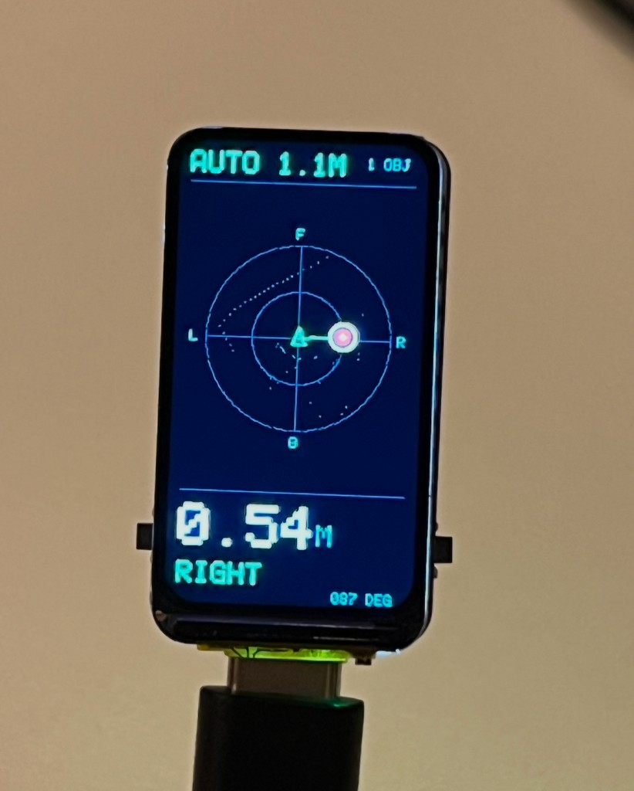

# Handheld display

A Wi-Fi display for the USB RPLIDAR C1 attached to your computer. The computer performs background subtraction and object tracking. The display renders a 360° scope, the nearest confirmed contact in metres, and faster LED pulses as a contact approaches. It does not measure a person's heartbeat or identify people.

Buy a [Waveshare ESP32-S3-LCD-1.47B](https://www.waveshare.com/ESP32-S3-LCD-1.47B.htm). These steps use that board. A Firefly Pixie also works, with a separate image, if you already have one. Each flash script reads the chip id and stops on the wrong chip, so a Waveshare image is not written to a Pixie or to the LiDAR adapter.

Both boards need **2.4 GHz Wi-Fi**. A 5 GHz-only network will not connect. The LiDAR stays on the computer over USB. After setup the display only needs USB power.

## Waveshare ESP32-S3-LCD-1.47B



ESP32-S3, 16 MB flash, a 1.47 inch 172×320 ST7789, one RGB LED, BOOT, RESET, and USB-C. Waveshare wires the panel as MOSI GPIO45, SCLK GPIO40, CS GPIO42, DC GPIO41, reset GPIO39, and backlight GPIO46. The RGB LED data pin is GPIO38. This image draws the scope at 172×320. BOOT cycles the range. RESET restarts the board. There is no rotate, contour, or LED button; the single LED uses the same waiting, calibration, scanning, and contact colors described below.

From the repository root, with Docker running. The first build downloads ESP-IDF v5.5.1 and can take several minutes. Downloads and build output stay in `.deps/` and are not committed.

```sh
python3 -m venv .deps/esp-tools
.deps/esp-tools/bin/pip install esptool pyserial
bash scripts/build-waveshare.sh
bash scripts/flash-waveshare.sh /dev/cu.usbmodem...
```

Choose the **Espressif** serial port. On macOS it looks like `/dev/cu.usbmodem…`. On Linux it is often `/dev/ttyACM0`. Do not select the LiDAR adapter (`/dev/cu.usbserial-…` or `/dev/ttyUSB0`).

The board then needs the 2.4 GHz network. The script asks for the network name and password. On macOS, `--mac-dialog` opens two system dialogs. On Linux, omit `--mac-dialog` and answer in the terminal. The password is sent only over USB and stored on the board. It is not written to the repository or to command-line arguments when you let the script ask.

```sh
.deps/esp-tools/bin/python scripts/provision-firefly.py --port /dev/cu.usbmodem... --mac-dialog
```

Pairing creates `.deps/firefly-device.json` (mode 0600) with a random 128-bit key and the board's address. The file is gitignored. Re-run setup to change networks. If DHCP changes the address, update `host` in that file and keep the same `key`. Pass `--ssid` only when you already have the name in a private shell and do not want the prompt. Pass `--config` for a second board so the first pairing file is not overwritten.

Start the demo with both devices:

```sh
FIREFLY_CONFIG=.deps/firefly-device.json C1_LIDAR_PORT=/dev/cu.usbserial-... npm run dev
```

Replace both USB paths with the ports on your machine. Open http://127.0.0.1:5174. Without `C1_LIDAR_PORT`, connect the C1 from that page. Without `FIREFLY_CONFIG`, the viewer runs and the handheld stays dark. The first scans learn the background; step aside so the sensor can see past you. Recalibrate an empty scene after moving the sensor. Ctrl+C stops the server and requests a LiDAR motor stop.

On startup the screen shows `CONNECTING` until Wi-Fi and DHCP finish, then `NO LINK` until packets arrive. `LIDAR OFFLINE` means packets are arriving but the sensor is not scanning.

## What the screen shows

The nearest contact has a large red marker with a white ring and a line from the sensor. Other contacts are smaller; contacts outside the visible radius use outward-pointing edge arrows. The room contour is subdued. The centre triangle is the sensor; F/R/B/L indicate its front/right/back/left, and rotate with the view. The bottom readout shows nearest distance, sensor-relative direction and clockwise bearing (0° front, 90° right). There is no decorative sweep.

AUTO sets the visible radius from the nearest confirmed contact, with approximately 28% headroom and a **1 m minimum**. The top-left label is the distance from the centre to the outer ring, not the diameter. A deadband suppresses tiny distance fluctuations; zoom-out is faster than zoom-in, and the nearest contact always fits. Brief contact loss holds the scale for two seconds, then smoothly returns to a 6 m search view; lost targets themselves disappear immediately. Use the range button for an overview of more distant contacts. A blue LED means waiting or offline, amber means calibration, green means scanning, and red pulses mean a contact. A stationary contact remains visible if tracking still observes it.

## Firefly Pixie

Use this image only if you already have a Pixie. It is an ESP32-C3 with 16 MB flash, a 240×240 ST7789 (SCLK GPIO6, MOSI GPIO7, DC GPIO4, reset GPIO5, no CS, ribbon at the bottom), four WS2812 LEDs on GPIO9, and active-low buttons on GPIO10, GPIO8, GPIO3, and GPIO2. Do not write this image to another chip.

```sh
bash scripts/build-firefly.sh
bash scripts/flash-firefly.sh /dev/cu.usbmodem...
```

Wi-Fi setup is the same `provision-firefly.py` command, pointed at the Pixie's USB port. Back up the existing flash before replacing someone else's firmware, and keep that backup private because it includes device settings:

```sh
.deps/esp-tools/bin/python -m esptool --chip esp32c3 --port /dev/cu.usbmodem... read-flash 0 ALL .deps/firefly-original.bin
```

Restore that backup, including its previous settings, with:

```sh
.deps/esp-tools/bin/python -m esptool --chip esp32c3 --port /dev/cu.usbmodem... write-flash 0 .deps/firefly-original.bin
```

Pixie buttons, in GPIO order:

- 10: AUTO → fixed 1 → 2 → 3 → 6 → 12 → 24 metres → AUTO. AUTO is the startup default.
- 8: rotate the view 90°.
- 3: show or hide the scan contour.
- 2: enable or disable LEDs.

The Waveshare BOOT button is the range button only.

## Transport and failure behavior

The server sends a 212-byte UDP datagram to port 8789 every 100 ms. Dashboard and control APIs remain bound to loopback. No LAN HTTP listener is added. This is a trusted-LAN protocol: the pairing key rejects accidental or unrelated senders, but is transmitted in plaintext and does not provide encryption or protection against a network observer.

Packet integers are little-endian:

| Offset | Content |
| --- | --- |
| 0 | `FFH1` magic (4 bytes) |
| 4 | Pairing key (16 bytes) |
| 20 | Random sender session (uint32) |
| 24 | Sequence (uint32), duplicates and out-of-order packets rejected within a session |
| 28 | State: 0 offline, 1 learning, 2 calibrated/live |
| 29 | Contact count, max 8, nearest first |
| 30 | Calibration percent; byte 31 reserved |
| 32 | Nearest distance, uint16 mm, 65535 = none; bytes 34–35 reserved |
| 36 | 72 uint16 radial bins in mm, minimum return per 5° bin, 0 = absent |
| 180 | Eight int16 X/Y pairs in mm, X right and Y forward |

The server clears contacts for stale scans (1.8 s), disconnects, and calibration. The display independently clears geometry and pulses if packets stop for 1.8 s or Wi-Fi disconnects. UDP loss needs no queue or retransmission; the next packet replaces the view. The framebuffer and scan bins are RAM-only. USB `STATUS` reports the current address, packet age, state, contact count, current radius and free heap, without credentials or raw scans. `FIREFLY_DISPLAY` also reports the submitted display-frame count, rendered packet sequence, last-frame age and distance. Stage 0 means waiting for the next frame, 1 drawing, 2 updating LEDs, and 3 submitting SPI fragments. Increasing frame and sequence counters distinguish ongoing rendering from a stalled loop.

## UI verification

`npm run test:firefly` compiles the portable C renderer on the host at the Pixie size, 240×240, and checks minimum range, retreat containment, smoothing, jitter suppression, temporary contact loss, manual and auto switching, and clearing stale contact geometry. It writes synthetic PPM previews under `.deps/firefly-ui/`. The Waveshare build compiles the same renderer at 172×320; that image is what `scripts/build-waveshare.sh` produces. GitHub Actions runs the host renderer test. It does not flash hardware.

## Several displays

Each device can receive the same live scan and keep its own zoom, rotation and LED settings. Give every device its own pairing file:

```sh
.deps/esp-tools/bin/python scripts/provision-firefly.py --port /dev/cu.usbmodem... --mac-dialog --config .deps/firefly-second.json
```

`FIREFLY_CONFIG` accepts either one `{ "host": "...", "key": "..." }` object or a JSON array of those objects. Combine existing pairing files locally and keep the file private:

```sh
python3 - <<'PY'
import json, os
paths = ['.deps/firefly-device.json', '.deps/firefly-second.json']
with os.fdopen(os.open('.deps/firefly-devices.json', os.O_WRONLY | os.O_CREAT | os.O_TRUNC, 0o600), 'w') as f:
    json.dump([json.load(open(p)) for p in paths], f)
PY
FIREFLY_CONFIG=.deps/firefly-devices.json C1_LIDAR_PORT=/dev/cu.usbserial-... npm run dev
```

USB is only needed for provisioning and power. Each display can run from a separate USB charger.
